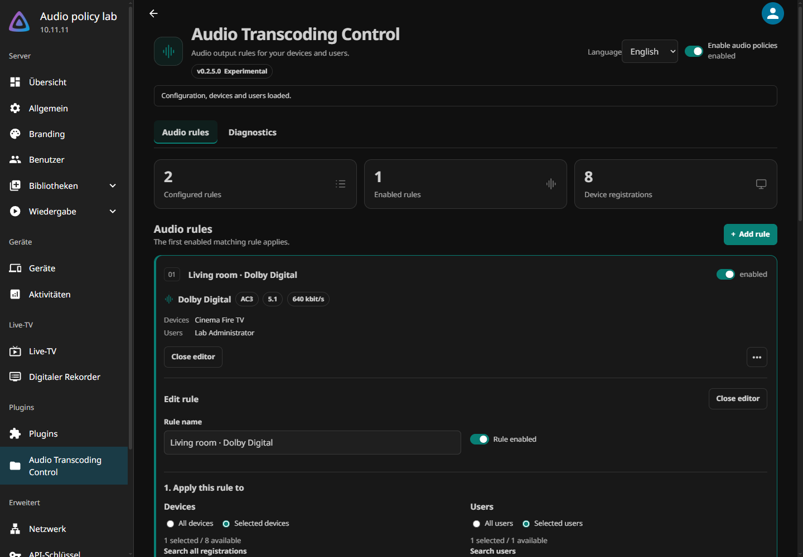

# M2.5 — Inline rule editing and playback log comparison

Version 0.2.5.0 targets Jellyfin 10.11.11. Schema 2 and the plugin GUID remain unchanged. Playback filters, credential binding, native permissions, audio formats and video/HDR handling are unchanged in this release.

## Deletion failure: evidence and correction

The reported correlation with incomplete rules was investigated in the 0.2.4 source. `Delete` did **not** call `collectEditor()` or validation before `rules.splice()`. It did immediately render a neighbouring editor; `renderEditor()` re-ran validation whenever `validationAttempted` was set. Routine `collectEditor()` also re-ran validation. This mixed management and validation and made the selected editor/index state unnecessarily fragile. Existing backend validation already allowed disabled drafts with empty device/user lists.

The focused seven-card browser check reproduced an additional concrete cause: `.atc-card-off { opacity: .8 }` creates a stacking context. The absolute overflow menu's `z-index: 5` remained inside that context, behind a subsequent card. The Delete entry could be visible but covered, and its click opened the subsequent card instead. Filling/enabling rules changes that presentation state; the reported correlation alone therefore does not prove a pre-delete validation exception. There was no useful distinction in the old logs: `Code: delete` was emitted before confirmation, without a rule ID or position, even when no deletion completed.

An open menu now raises its containing card above adjacent cards. All actions resolve the current rule by its stable internal UUID at execution time. Synchronization copies edits without validating. Deletion, deactivation, reordering and editor closure never require device/user selections. Activation explicitly validates the affected rule; Save validates the complete proposed configuration. Disabled drafts with empty selections and an empty rule list are valid; empty selections never imply All. Other structural limits and backend validation remain in force.

Deletion uses Jellyfin's native confirmation dialog and includes the rule name. Cancel leaves the configuration untouched. Confirmation rechecks the current rule ID and page generation before mutation; deleting the expanded rule closes the editor. Deletion remains unsaved until Save configuration.

## Inline cards

- All rules start collapsed after loading, with no automatically selected rule.
- Card body/header or Edit opens the same card across the available grid width. Close editor/header closes it. Opening another rule closes the previous one.
- Exactly one editor instance exists. An inert template is consumed once, and the editor is detached when closed. There is no separate editor below the grid and no competing hidden form.
- Edits stay in memory across closing, switching, duplicating, reordering and deleting another rule. None of these operations saves automatically.
- Toggle and overflow actions do not expand cards. Header buttons support keyboard activation, `aria-expanded`, and focus return; explicit editing focuses the rule name.
- Existing device grouping, checkbox selections, diagnostics, English/German labels and scoped theme styling remain available.

[Narrow-screen capture](images/m25-inline-rule-mobile.png). Screenshots show only the isolated laboratory and synthetic registrations.

## Action diagnostics

`[ATC:UI]` rule-action events include the internal rule UUID, actual one-based position, activation state, counts before/after, enabled-rule count, dirty state, result and an allowlisted reason. Delete distinguishes requested, confirmed, cancelled, succeeded and failed. Add, edit, expand, collapse, change, duplicate, enable, disable and reorder use the same context. Validation retains field-specific reasons and selection counts. Actual HTTP status is recorded when available; otherwise it is explicitly unknown.

The existing administrator-only native log bridge accepts these bounded scalar fields. Rule names, raw device/user identities, credentials and HTTP payloads are not added to diagnostics. Old UI builds remain accepted by the bridge.

## Focused verification

Release build: zero warnings/errors. Existing tests plus one focused disabled-draft/empty-list serialization regression: **51 passed**. The existing diagnostic bridge test also checks the new action metadata and rejection of arbitrary reason strings. No test framework, dependency or CI was added.

The existing isolated Jellyfin 10.11.11 / bundled Jellyfin Web instance was used for these regression checks:

| Case | Result |
| --- | --- |
| Initial load with one rule; reload with two rules | All collapsed, no mounted editor |
| One, two and seven cards; switch and close with unsaved name changes | One inline editor, edits retained |
| Incomplete activation | Rejected with separate device/user field hints; draft remains disabled |
| Disabled draft without devices/users, Save and Reload | Accepted, selections remain empty |
| Native delete confirmation cancelled | Rule and other edits retained |
| Seven rules deleted through middle, first and last positions | Immediate correct counts, including zero |
| Expanded/collapsed deletion, deletion after reorder | Correct stable-ID target |
| Delete another card while editing | Name and selected device/user preserved |
| Empty list, Save and Reload | Zero rules; deleted rules do not return |
| **Add a new rule, select no devices/users, immediately Delete, Save, Reload** | **Zero rules** |
| Duplicate, reorder, enable/disable, language and Diagnostics views | Functional; toggles do not expand cards |
| Desktop 1440, tablet 768 and phone 390 viewport widths | Full-grid expanded card, one editor, no horizontal document overflow |
| Diagnostic forwarding | Native server accepted 0.2.5.0 action results/counts; no interface error events |

Only the isolated process was restarted and stopped. The production server was read for log evidence only.

## Dark Knight: production evidence, not a speculative playback fix

The available November 28 production log comparison shows:

| Film | Selected source / native mapping | Actual FFmpeg output declaration |
| --- | --- | --- |
| The Dark Knight | TrueHD, six channels, 48 kHz, 24-bit; audio stream 1 → output 1 | AC3, 48 kHz, `5.1(side)`, 640 kbit/s |
| Dune: Part Two (two jobs) | EAC3, six channels, 48 kHz; audio stream 1 → output 1 | AC3, 48 kHz, `5.1(side)`, 640 kbit/s |
| LOTR (three jobs) | TrueHD stream 3, then AC3 stream 4 → output 1 | AC3, 48 kHz, `5.1(side)`, 640 kbit/s |

All compared jobs declare video stream copy, contain written video frames and show no `Conversion failed`. For Dark Knight specifically, native stream mapping is `truehd (native) -> ac3 (native)`, the output encoder initializes successfully, and the final muxer summary reports nonzero audio bytes written. Its actual command contains `-codec:v:0 copy -codec:a:0 ac3 -ac 6 -ab 640000`.

The corresponding server decision sequence records retained PlaybackInfo context, verified native credential association, `contextFound=True`, current TrueHD track index 1 with six channels, and progressive AC3 application at six channels/640000 bit/s. The differing native registration/routing identity is successfully associated. Subsequent comparison jobs show Dune and LOTR policy application, rather than a demonstrated Dark Knight AAC fallback. Older AAC logs predate these current AC3 jobs and are not evidence of a fallback in the current comparison. These excerpts do not establish which bytes the player ultimately rendered, and do not provide a complete packet-level audit of all later client requests.

This establishes native encoder initialization and output metadata; it does **not** prove audible content in every channel, client passthrough, or the HDMI/ARC signal received by the receiver. No surviving output file was required or regenerated from the original movie. The user reports Dolby Digital 5.1 for Dune/LOTR, but not for Dark Knight. The available evidence does not justify changing the working playback policy or video pipeline.

For the next hardware comparison, start a fresh Dark Knight playback with the explicitly selected TrueHD 5.1 track, note its start time, and inspect the player's audio/passthrough information alongside the receiver's **input signal** channel indication. Compare a known multichannel scene with a fresh Dune playback using the same output settings. If Dark Knight differs, provide only sanitized same-session playback/FFmpeg evidence and receiver/client observations. This separates generated AC3 metadata from client decoding/output and HDMI/ARC handling without changing server permissions or video processing.
